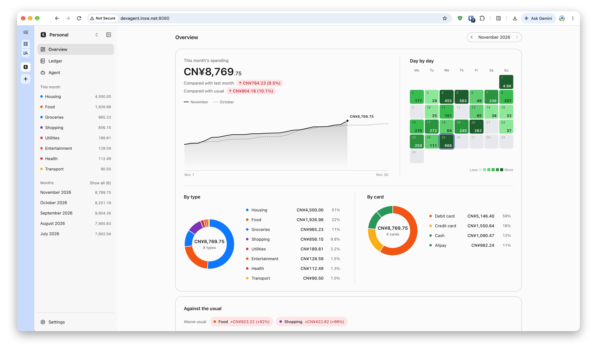

<p align="center">
  
</p>

<h1 align="center">Paylist</h1>

<p align="center">
  <strong>Your spending, month by month: a ledger you write in, an overview that shows where it went,<br>and an agent that keeps the books for you, with your own AI key.</strong>
</p>

<p align="center">
  Self-hosted · one Go binary · SQLite · English and 中文 · light and dark
</p>

<p align="center">
  
</p>

---

Paylist is a personal and household spending tracker you run yourself. Every expense is one line, with a name, a type, an amount, a date and the card it was paid with, kept month by month. You write them down in a few keystrokes; Paylist shows you the month at a glance; and an AI agent (yours, on your own key) can add, fix and answer questions about them. Agents you already use, such as Claude Code, can do the same over MCP.

## Overview

Paylist opens on the month at a glance.

- **This month's spending** against the same days of last month, and against the usual: the average of the six months before, up to the same day.
- **Cumulative spending** through the month, drawn over last month's, so you see whether you're ahead or behind.
- **Day by day**: a calendar shaded green by how much went out each day, and red where more came back.
- **By type** and **by card**: two donuts, with the share of each.
- **Against the usual**: each type this month against its usual month, the furthest above first, with its last twelve months as a sparkline: where the spending grew, so where to look to spend less next month.
- **Monthly spending** for the last twelve months, with the average, highest and lowest month, and each month's change on the one before.
- **The year** against the same days of last year, its months beside last year's, and by type.

Click a day, a type or a card to open its entries in a window, and click an entry to change it.

## Ledger

One month as a table, edited in place, like a spreadsheet.

- **Press N** anywhere to add an entry. The form stays open for the next one, and as you type a name it offers the ones you've used before (by pinyin too: "kf" finds 咖啡), filling in the type, card and last amount.
- **Press R** for a refund, filled in like a new entry. If a purchase from the last 120 days has the same name and amount, it is deleted (with Undo); if not, the refund is added as a negative amount.
- **Paid in another currency?** Choose it at the bottom of the form and type the amount in it: Paylist shows what it comes to at that day's exchange rate, and saves that, in the ledger's currency, with what you paid beside it (US$12.50). Rates are the European Central Bank's, from [Frankfurter](https://frankfurter.dev), or for currencies it doesn't cover, today's from [ExchangeRate-API](https://www.exchangerate-api.com).
- Click any cell to change it; Enter or Esc saves. Types and cards are colored options, found by name or pinyin; a new name is created once you confirm it.
- **Filter** by name, type, amount, date or card, each a chip you can change, and **Sort** by date, amount or name, setting the one you like as the default. Search, select rows to delete several at once, and export the month as CSV.
- The header keeps the month to date and the change from last month in view; the sidebar keeps this month's spending by type and your recent months a click away.

## Agent

Chat with an assistant that works on your ledger:

> add lunch 35 and a metro ride 4.5 today, paid by card
>
> add a coffee
>
> I got 299 back for the headphones
>
> compare this month with last month, type by type

- **Bring your own key**: Anthropic (Claude), OpenAI, DeepSeek, OpenRouter, Qwen, Moonshot, Ollama, or any other OpenAI-compatible API with tool calling. Keys are stored encrypted on your server and never sent back to the browser.
- The agent uses the same MCP tools as outside agents, and you see every call it makes, with what went in and what came back.
- It works in the background: leave the page, or close it, and the turn goes on; the sidebar shows the agent at work, and a note says when it has replied. A turn that makes no progress for five minutes is closed.
- Conversations are saved as they go, so you can pick one up later.

## MCP

Paylist is an MCP server. Create a token in **Settings → Agent access** and connect Claude Code, Codex, Cursor or any MCP client:

```sh
claude mcp add --transport http paylist https://pay.example.com/mcp \
  --header "Authorization: Bearer plt_…"
```

| Tool | Does |
|---|---|
| `list_ledgers` | The user's ledgers, their own and those shared with them, with their role in each. Every other tool takes an optional `ledger` (a name or an id); without it, the ledger last open in Paylist |
| `manage_ledger` | Make a ledger; as its owner, rename it, change its currency or delete it; or leave one shared with you |
| `ledger_people` | Who has a ledger, and their roles; its owner invites people by their account's email, changes roles and removes them |
| `get_profile` | A ledger's name and currency, the user's name, role and language, and today's date |
| `list_entries` | Entries of a month or a date range, optionally of one type or card, or with names containing some text; with their count and total, and what was paid in another currency |
| `add_entries` | Add entries, all or none. The date defaults to today; a new type or card becomes an option; with a `currency`, the amount is converted at that day's rate and what was paid kept |
| `update_entry` | Change the fields given, the amount in a `currency` too |
| `delete_entries` | Delete entries by id |
| `refund` | Record a refund the way the ledger's Refund form does: a purchase from the last 120 days with the same name and amount is deleted; with several, they come back to pick from; with none, the refund is added as a negative amount under the type, card and date given. Given a purchase's id and less than it cost, takes that part off it; `new` adds it as its own; a `currency` converts it |
| `get_history` | An entry's history: who created and changed it, through what, and every change from what to what |
| `suggest_entries` | Names used before that contain some text, with how each was last entered (type, card, amount), to fill in what the user leaves out |
| `list_options` | The types and cards, in their order, with their colors, how many entries use each and when one last did |
| `manage_option` | Create, rename, recolor, delete or reorder the types or cards; renaming carries through to every entry |
| `get_stats` | A month's total, change from the same days of the month before and from the usual, daily totals, totals by type and by card, each type month by month, and the year against the last |
| `list_months` | Every month with entries, with its total and count |
| `get_exchange_rate` | What one currency is worth in another on a day |
| `channels` | Where the user is sent messages: list, add, change, remove or test a webhook (with headers of their own), Slack, Discord, Feishu, DingTalk, WeCom, Bark or ntfy channel |
| `ledger_reports` | The reports the user gets of a ledger, brief notes on how a day, week or month compares with the usual: turn them on or off, set their time, time zone, language, channels and whether AI adds a suggestion, or preview or send one now |

Everything you can do with your ledgers in Paylist, an agent can do through these tools. Account settings, passwords, model keys, tokens and the server's accounts stay in the app.

A token reaches only its owner's ledgers, those shared with them included, with the same role they have in the app, and can be revoked at any time.

## Reports

Paylist can send you a brief note on a ledger's spending: how the day, week or month compares with the usual, and the types that rose or fell most.

```
💰 Paylist Report · Personal

Yesterday (Tue, Nov 24)
  Total ¥245.50
  ↑ much higher than usual (¥105.20 a day)

Month so far
  Total ¥3,210.00
  ↑ higher than usual (¥2,720.00 by now)

By type, month so far
    ↑ Shopping +133%
    ↓ Transport -76%
```

- **Channels**, in **Settings → Channels**, are where it goes: a webhook (sent Paylist's JSON, with headers of your own such as `Authorization`, kept encrypted and never shown again), Slack, Discord, Feishu, DingTalk, WeCom, Bark or ntfy. **Test** sends one a short message; one that fails says why.
- **Reports**, in each ledger's **Ledger settings**, are yours to choose, on a shared ledger too: **daily** (yesterday against a usual day, and the month so far), **weekly** on Mondays (last week against the eight before) and **monthly** on the 1st (last month against the usual month), at the time and in the language you pick, to the channels you pick. **Send now** sends one at once.
- **AI suggestion**: with an AI model chosen in Settings and the switch on, it ends the note with a short paragraph on what was unusual, such as what is behind the types that rose or fell (one large purchase, many small ones, something new), and a suggestion or two for the next day, week or month to keep spending below its usual, or at least at it. A daily or weekly one also looks at where the month is heading: when a few heavy days or weeks are pushing it over its usual, it says how to pace the rest of it. Before writing, it can look into the ledger (its entries and months before) through the MCP tools that only read it. The report then ends with a link to the agent page, to ask more: the address set by `PAYLIST_PUBLIC_URL`, or else the one Paylist was last opened at.

## Ledgers, shared

Everyone starts with a personal ledger and can make more, such as one for the household or a trip, each with its own entries, types, cards and currency.

- **Switch** from the ledger's name at the top of the sidebar; the same menu makes a new ledger and opens the open one's **Ledger settings**.
- **Ledger settings** hold its name and currency, the people who have it, and its types and cards, and end with deleting it (or leaving one shared with you).
- **Share** a ledger by the email of someone's Paylist account on the same server, as an **editor**, who changes it as the owner does, or a **viewer**, who only reads it. Only the owner renames it, changes its currency, shares it or deletes it.

The agent works on the ledger that's open; over MCP, on the ledger last open in Paylist, or one named by its name.

One server holds everyone, each with their own ledgers, model and key. The first person to open a new server becomes its admin and adds the others in **Settings → Accounts**.

## Get started

### Try the demo

You need [Go](https://go.dev/dl/) 1.27+ and [Node.js](https://nodejs.org/) 20+ (or Docker, which `make` uses to build the web app when Node is missing).

```sh
make demo
```

Open <http://localhost:8080> and sign in as `demo@admin.com` / `admin`. The demo account comes with six months of made-up spending, and an offline **Demo model** for the agent that needs no key (it understands `add <name> <amount> [type] [card]`). `make demo-reset` starts it over. The demo password is short, so keep it on your own machine.

### Run it with Docker

```sh
docker run -d --name paylist --restart unless-stopped \
  -p 8080:8080 -v paylist-data:/data xavierniu/paylist
```

Open <http://localhost:8080> and create the admin account; whoever opens a new server first becomes its admin, so do it right away, or create it up front with `-e PAYLIST_ADMIN_EMAIL=you@example.com -e PAYLIST_ADMIN_PASSWORD='a long password'`.

Behind an HTTPS proxy (Caddy, nginx), also set `-e PAYLIST_SECURE_COOKIES=1 -e PAYLIST_PUBLIC_URL=https://pay.example.com`.

Images are built for amd64 and arm64 from every push to `main` (`latest`) and every `v*` tag. To build your own: `docker build -t paylist .`

### Back up

Everything lives in the data directory: `paylist.db`, and `secret.key`, which encrypts the stored API keys. Back them up together; without `secret.key`, everyone has to enter their API key again.

## Configuration

| Flag / env | Default | Meaning |
|---|---|---|
| `-addr` / `PAYLIST_ADDR` | `127.0.0.1:8080` (`0.0.0.0:8080` in Docker) | Listen address |
| `-data` / `PAYLIST_DATA` | `./data` (`/data` in Docker) | Holds `paylist.db` and `secret.key` |
| `PAYLIST_SECRET` | generated into `secret.key` | 32-byte key (hex or base64) that encrypts stored API keys |
| `PAYLIST_ADMIN_EMAIL`, `PAYLIST_ADMIN_PASSWORD` | unset | Create this admin on first start (only while there are no accounts) |
| `PAYLIST_SECURE_COOKIES=1` | off | Mark the session cookie `Secure`; set it when serving over HTTPS |
| `PAYLIST_PUBLIC_URL` | from the requests | How people reach the server: the MCP address, and the link at the end of a report. Without it, the address the app was last opened at |
| `-static` / `PAYLIST_STATIC_DIR` | embedded | Serve the web app from a directory instead, such as `web/dist` |
| `PAYLIST_DEV_FAKE=1` | off | Offer the offline demo model. For demos and tests only |
| `PAYLIST_DEMO_SEED=1` | off | Fill the `PAYLIST_ADMIN_EMAIL` account's empty ledger with demo data |

Accounts can also be managed from the command line:

```sh
paylist user add -email you@example.com [-name "You"] [-admin]
paylist user list
paylist user passwd -email you@example.com
paylist user delete -email you@example.com
```

## Development

```sh
make build        # the web app (web/ui → web/dist), then ./paylist with it embedded
make test         # go vet and the Go tests
make demo         # the demo server on :8080
make ui-dev       # the web app with hot reload on :5173, using the API on :8080
```

```
cmd/paylist/        main: serve, the `user` subcommands, and the demo data
internal/store/     SQLite: users, sessions, tokens, entries, options, statistics, agent chats; API-key encryption
internal/server/    HTTP API, sessions and CSRF guard, the MCP server (mcp.go), the agent endpoint (agentchat.go)
internal/agent/     the agent loop: the model, with the MCP server's tools through an MCP client session
internal/llm/       model adapters: Anthropic (official Go SDK), OpenAI-compatible (Chat Completions with tools), the demo model
web/ui/             the web app: React, TypeScript, Tailwind CSS and shadcn/ui, built by Vite into web/dist
web/embed.go        embeds web/dist into the binary
```

The agent's model runs on the server, with the key stored there: each turn opens an MCP client session to an in-memory MCP server for the signed-in user, lists its tools, and loops (model → tool calls → results) until the model answers, streaming text and tool activity to the browser as newline-delimited JSON. With Claude it runs at medium effort with prompt caching, uses the server-side refusal fallback where the model supports it, and replays Claude's earlier replies exactly as written.
